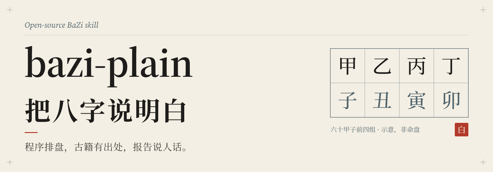
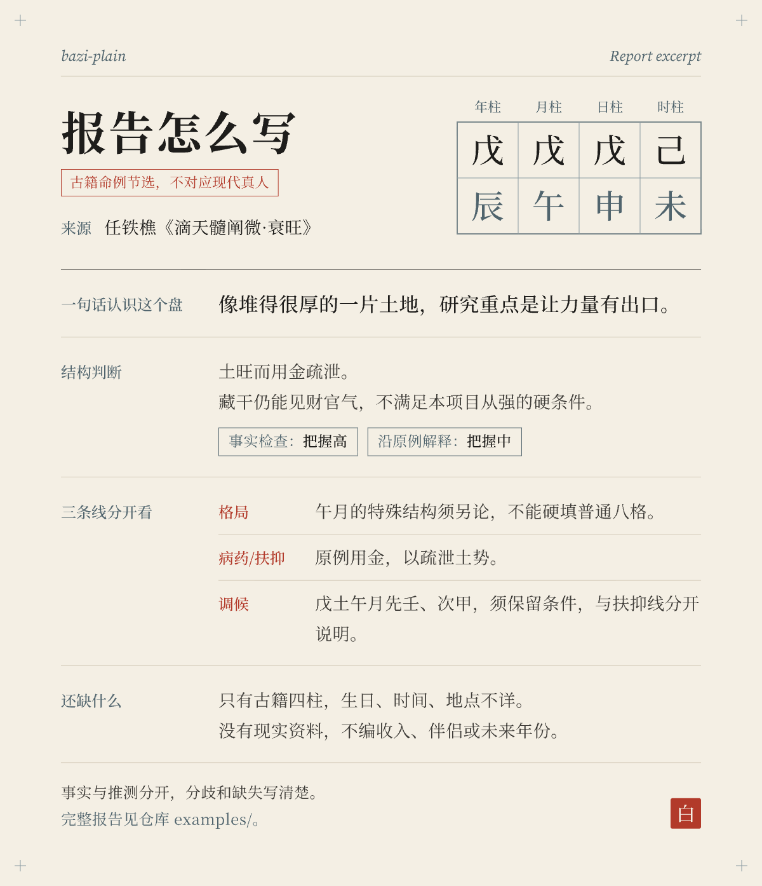

<p align="center">
  
</p>

# bazi-plain

**把八字说明白。** 程序排盘，古籍有出处，报告说人话。

[](https://github.com/yummyooyummy/bazi-plain/actions/workflows/tests.yml)
[](LICENSE)

[English](README_en.md) · [安装](docs/install.md) · [使用](docs/usage.md) · [常见问题](docs/faq.md) · [方法与出处](docs/method-and-sources.md) · [隐私](docs/privacy.md)

---

bazi-plain 是一个给 AI 助手用的八字技能（Agent Skill）。它分三块：

- **排盘**交给本地 Python 程序。四柱、真太阳时、节气交界、大运流年、藏干十神等，一律由程序算，模型不心算。
- **解释**按固定的方法资料来。资料整理自《子平真诠》《滴天髓阐微》《穷通宝鉴》，每条规则都标了篇目。
- **报告**用普通人看得懂的话写，每条判断都标“把握：高 / 中 / 低”。拿不准的地方先问你几个问题，再往下写。

它是传统文化的学习和参考工具，不是科学预测，也不替你做婚姻、职业、医疗、投资上的决定。

## 报告长什么样

<p align="center">
  
</p>

下面是公版古籍命例的节选，不是现代真人。这个盘出自任铁樵《滴天髓阐微·衰旺》：

> **戊辰　戊午　戊申　己未**
>
> **一句话：** 像堆得很厚的一片土地，关键是有没有能持续疏泄的出口。（把握：低，只是学习比喻）
>
> **采用哪种读法：** 偏强的厚土，主取金来疏泄，不按“从强”论。（把握：中）
> 土字虽多，但辰里藏乙、癸，申里藏壬，从强要求的“完全没有财官之气”不成立。原书也明说“其用在金”。
>
> **财：** 财藏在地支里，不等于钱已经能用上。要先看金能不能生水，厚土会不会把水压住。（把握：中）

完整推导见[方法自测01](examples/方法自测01-土旺用金.md)；按报告模板各栏写的短版在[示例报告](docs/example-report.md)。

## 为什么把程序和解释分开

让模型自己从生日推到四柱，中间的计算链很长，每一步都有出错的可能，比如：

- 日柱推错一天；
- 节气交界附近的月柱弄错；
- 忘了用真太阳时；
- 晚上 11 点到 12 点之间，只给一种日柱。

排盘一旦错了，后面的解释就是在讲另一张盘。

所以这里让程序只管“事实”，模型只管“解释”。两件事的检验方式也不同：

- **程序的计算可以测。** 仓库里的测试覆盖四柱、交节、真太阳时、晚子双盘、大运起止等用例；节气时刻还和另一个独立天文算法逐项比过，详见[方法与出处](docs/method-and-sources.md)。测试通过，只说明已覆盖用例的计算结果符合验收答案，不等于所有没测到的边界都对。程序默认的历法约定（比如早晚子怎么分）也只是其中一种流派，不是唯一标准。
- **传统解释没法用测试证明。** 测试再全，也不说明“喜金”“财运一般”这类结论在现实里会应验。方法资料里约 126 项带编号的检查，是可以追溯到书篇的参考方法，不是经过验证的预测规则。

## 三步安装

需要 Git 和 Python 3.9 或更新版本。下面以 Claude Code 为例，macOS / Linux：

```sh
# 1. 下载到 Claude Code 的个人技能目录
git clone https://github.com/yummyooyummy/bazi-plain.git ~/.claude/skills/bazi-plain

# 2. 在技能目录里建虚拟环境，装锁定版本的依赖
cd ~/.claude/skills/bazi-plain
python3 -m venv .venv
.venv/bin/python -m pip install -r requirements.txt

# 3. 用公版古例试一下，能输出一段 JSON 就说明程序能跑
.venv/bin/python scripts/paipan.py --chart 戊辰 戊午 戊申 己未
```

不想用 Git 的话，可以在 GitHub 页面点 **Code → Download ZIP**，解压后把文件夹改名为 `bazi-plain`，放到同样的位置。Windows 用户、Codex 用户和想跑测试的人请看[安装说明](docs/install.md)。

安装本身不需要 API 密钥，也不会调用任何在线算命服务。只有下载依赖时需要联网。

## 在不同工具里怎么用

| 工具 | 放在哪里 | 怎么叫它 |
| --- | --- | --- |
| Claude Code | `~/.claude/skills/bazi-plain/`（个人）或项目里的 `.claude/skills/bazi-plain/` | 输入 `/bazi-plain`；也可能根据你的问题自动选用 |
| Codex | `~/.agents/skills/bazi-plain/`（个人）或项目里的 `.agents/skills/bazi-plain/` | 输入 `$bazi-plain`，或用 `/skills` 选择；也可能自动选用 |
| 其他模型 | 不需要特定目录 | 把 [SKILL.md](SKILL.md) 作为任务说明，再按需提供 `references/` 里的资料和程序生成的事实包 |

目录名要和 SKILL.md 里的 `name: bazi-plain` 一致，这是 [Agent Skills 规范](https://agentskills.io/specification)的要求。

会不会“自动选用”，取决于各家工具怎么匹配技能描述，这里不做保证。想确定用上，就直接输入上表里的命令。

技能的规则写明：程序跑不起来时，不允许模型自己排盘，要先把依赖装好，或者由你提供已经生成的事实包。

没有代码执行能力的模型（比如普通网页聊天）自己不排盘，分两种情况：

- 你提供了本程序实际生成的完整事实包：模型可以解释其中的事实，并注明事实包由你提供；
- 只有 App 算的四柱、截图或来源不明的四柱：报告要标明“排盘未经本程序核验”，缺的大运、十神等不由模型补算。

## 晚子时、边界和校准

- **晚子时给两张盘。** 真太阳时落在 23:00 到 24:00 之间，同时输出两种口径：日柱不换的“早晚子分开”，和 23 点就换日的口径。两张盘都保留各自的十神和运年，先用性格和经历来校准，不默认只给一张。
- **离边界近也给两张盘。** 出生时间离时辰交界、日界或节气交界不超过 30 分钟（正好 30 分钟也算），主盘和相邻盘都会列出来。
- **读法有分歧时用百分比。** 一个盘有两种说得通的读法时，按固定计分表算倾向，这个百分比是规则内的倾向分，不是事件发生的概率。
  - 低于 60%：先问校准问题，问完再写完整报告；
  - 60%—79%：两种说法并列；
  - 80% 及以上：直接写，问题放在末尾核对。

细节见[使用说明](docs/usage.md)。

## 方法从哪来

| 来源 | 用在哪里 |
| --- | --- |
| 《子平真诠》 | 按月令取格、格局成败、顺用逆用 |
| 《滴天髓阐微》 | 衰旺、从格的硬条件、六亲 |
| 《穷通宝鉴》 | 调候表（十天干 × 十二月） |
| 梁湘润《子平概论》、王德峰《中国古代命理学》讲座 | 只做方法归纳并注明出处，仓库里没有课程原文或逐字稿 |

逐条出处在[规则出处](references/classics/规则出处.md)，整体说明在[方法与出处](docs/method-and-sources.md)。

## 隐私

- 仓库里没有任何真实人物的生日、命盘或经历。示例只用公版古籍命例和合成日期。
- 程序在你自己电脑上运行。默认输出的事实包不含原始出生日期，但四柱本身仍然算个人信息。
- 在聊天里报生日，生日就已经发给了那个聊天服务。想不经过模型服务，就在本地填输入文件运行程序，再只把事实包交给模型。

详见[隐私说明](docs/privacy.md)。

## 局限

- 出生年份只支持 1901—2099。
- 城市坐标是行政代表点，不是医院位置；需要更精确时请直接给经度和时区。
- 节气时刻与独立算法的差异最大约一分钟，所以边界附近一律给两张盘。
- 尚未做过多个模型重复运行的一致性评测，所以不宣称“换哪个模型都一样准”。
- 方法资料和报告模板目前只有中文。
- 健康部分只写日常保养方向，不做诊断，不预测疾病、寿命或事故。

## 参与贡献

欢迎报告排盘错误、补充古籍出处、改进说明文字。提交前请读 [CONTRIBUTING.md](CONTRIBUTING.md)。请不要在 issue 或 PR 里贴真实生日，复现问题请用合成时间或古籍四柱。

## 许可证

原创代码和文档采用 [MIT](LICENSE)。城市数据来自 GeoNames（CC BY 4.0），lunar-python、Astronomy Engine 等依赖保留各自许可证，详见 [THIRD_PARTY_NOTICES.md](THIRD_PARTY_NOTICES.md)。

更新记录见 [CHANGELOG.md](CHANGELOG.md)。早期开发过程的记录（[RESEARCH.md](RESEARCH.md)、[DECISIONS.md](DECISIONS.md)、[VALIDATION.md](VALIDATION.md)）作为历史资料保留。
