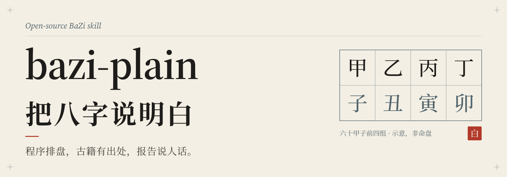
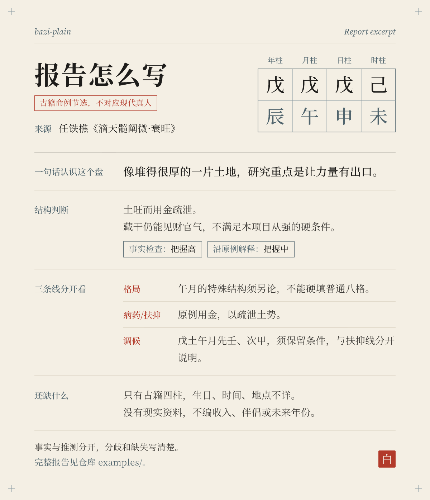

<p align="center">
  
</p>

# bazi-plain

**BaZi, explained plainly.** A program computes the chart, the method notes cite their sources, and the report uses everyday language.

[](https://github.com/yummyooyummy/bazi-plain/actions/workflows/tests.yml)
[](LICENSE)

[中文](README.md) · [Install](docs/install.md) · [Usage](docs/usage.md) · [FAQ](docs/faq.md) · [Method & sources](docs/method-and-sources.md) · [Privacy](docs/privacy.md)

The detailed docs are in Chinese. This page covers what you need to install and evaluate the project.

---

bazi-plain is an Agent Skill for reading BaZi (Four Pillars of Destiny) charts with an AI assistant. It keeps three jobs apart:

- **Facts come from a local Python program.** This covers the four pillars, apparent solar time, solar-term boundaries, luck periods, annual pillars, hidden stems and ten gods. The model is told never to compute these itself.
- **Interpretation follows fixed method notes.** The notes are drawn from three public-domain classics (*Ziping Zhenquan*, *Ditian Sui Chanwei*, *Qiongtong Baojian*), with a chapter reference for each rule.
- **Reports use plain language.** Each judgement is tagged with a confidence level (high / medium / low). When a chart can be read two ways, the skill asks a few calibration questions before writing the full report.

This is a tool for studying a cultural tradition. It is not a scientific prediction and is not advice on marriage, career, health, money or any other decision.

## What a report looks like

<p align="center">
  
</p>

The example below is a public-domain chart from *Ditian Sui Chanwei* (section on strength), not a living person:

> **戊辰 戊午 戊申 己未** (four Earth stems)
>
> **Reading adopted:** strong, thick Earth that needs Metal as an outlet; *not* a "follow the strong" chart. (confidence: medium)
> The branches still hide Wood and Water (辰 holds 乙 and 癸, 申 holds 壬). The "follow the strong" pattern requires those to be completely absent, so it does not apply. The original text also says Metal is the useful element.

The full step-by-step derivation (Chinese) is in [examples/方法自测01-土旺用金.md](examples/方法自测01-土旺用金.md).

## Why the program and the interpretation are separate

Going from a birth date to the four pillars is a long chain of calculations, and each step can go wrong when a model does it in its head, for example:

- a day pillar off by one;
- the wrong month near a solar-term boundary;
- no apparent-solar-time correction;
- a single day pillar for a birth between 23:00 and 24:00, when there should be two.

If the chart is wrong, the interpretation is about a different chart.

The two halves are checked differently:

- **Calculations are tested.** The tests cover pillars, solar terms, apparent solar time, late-Zi dual charts and luck-period dates. Solar-term instants for 1901–2099 were also compared item by item against an independent astronomy library. Passing tests means the covered cases match their expected answers; it does not prove that every untested edge case is right. The program's default calendar conventions (such as how the Zi hour is split) are one school among several, not the only standard.
- **Traditional interpretation cannot be tested this way.** Tests say nothing about whether "Metal is favourable" or "a modest year for money" will come true. The roughly 126 numbered checks in the method notes are a traceable reference method, not validated predictive rules.

## Install in three steps

You need Git and Python 3.9 or newer. Example for Claude Code on macOS / Linux:

```sh
# 1. Clone into your personal Claude Code skills folder
git clone https://github.com/yummyooyummy/bazi-plain.git ~/.claude/skills/bazi-plain

# 2. Create a virtual environment inside the skill and install pinned dependencies
cd ~/.claude/skills/bazi-plain
python3 -m venv .venv
.venv/bin/python -m pip install -r requirements.txt

# 3. Smoke test with a public-domain chart (prints JSON)
.venv/bin/python scripts/paipan.py --chart 戊辰 戊午 戊申 己未
```

No API key is needed. The program does not contact any online service at run time; only installing dependencies needs a network connection. For Windows, Codex and running the test suite, see [docs/install.md](docs/install.md) (Chinese; the commands are self-explanatory).

## Using it with different tools

| Tool | Folder | How to call it |
| --- | --- | --- |
| Claude Code | `~/.claude/skills/bazi-plain/` or a project's `.claude/skills/bazi-plain/` | type `/bazi-plain`; Claude may also pick it automatically |
| Codex | `~/.agents/skills/bazi-plain/` or a project's `.agents/skills/bazi-plain/` | type `$bazi-plain` or choose it via `/skills`; Codex may also pick it automatically |
| Other models | anywhere | give the model [SKILL.md](SKILL.md) as instructions, plus the relevant `references/` files and the JSON produced by the program |

The folder name must match `name: bazi-plain` in SKILL.md, as the [Agent Skills specification](https://agentskills.io/specification) requires.

Automatic selection depends on each tool. Use the explicit command if you want to be sure the skill is used.

A model that cannot run code does not compute the chart itself. If you give it a complete fact packet produced by this program, it may interpret those facts and should say the packet was supplied by you. If it only has pillars from another app, a screenshot or an unknown source, the report must say the chart was not verified by this program, and missing items are not filled in by the model.

## Boundaries and calibration

- **Late Zi hour.** If apparent solar time falls between 23:00 and 24:00, the program always outputs two charts: one keeps the same day, the other changes the day at 23:00. Both keep their own ten gods and luck periods.
- **Near a boundary.** When the birth time is 30 minutes or less (inclusive) from an hour, day or solar-term boundary, the neighbouring chart is listed too.
- **Two plausible readings.** The skill computes a tendency score with a fixed rule table. The score is bookkeeping inside the method, not a probability.
  - Below 60%: it asks calibration questions first.
  - 60–79%: it writes a full report with both readings side by side.
  - 80% and above: it writes the full report and lists the questions at the end.

## Privacy

- The repository contains no real person's birth data, charts or life events. Examples use public-domain classical charts and synthetic dates.
- The program runs on your machine, and by default its output omits the raw birth date. The four pillars are still personal data, though.
- If you type a birth date into a hosted chat, that service has received it. To keep the date local, run the program yourself and share only the fact packet.

See [docs/privacy.md](docs/privacy.md).

## Limitations

- Birth years 1901–2099 only.
- City coordinates are administrative reference points. Give longitude and an IANA time zone if you need more precision.
- No multi-model consistency evaluation has been run.
- Method notes and the report template are in Chinese.
- Health sections give general self-care directions only: no diagnosis and no predictions of illness, lifespan or accidents.

## Contributing and license

Bug reports with synthetic or classical inputs, source corrections and documentation fixes are welcome. Please read [CONTRIBUTING.md](CONTRIBUTING.md), and never post a real person's birth data in an issue.

Original code and docs are licensed under [MIT](LICENSE). The GeoNames city data is CC BY 4.0. Each dependency keeps its own license; see [THIRD_PARTY_NOTICES.md](THIRD_PARTY_NOTICES.md). Changes are listed in [CHANGELOG.md](CHANGELOG.md).
